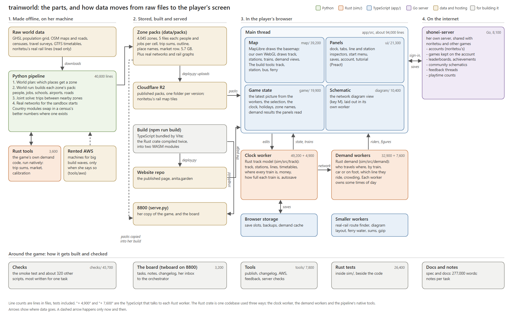

# A tour of the trainworld code

What the code is made of, where each part lives, and how a city's raw data becomes the trains on a player's screen. Written for reading, not for finding a line of code: for that, use `docs/code-map.md`. Sizes are rounded and from 2026-11-18.

The line counts printed on the picture are from 2026-11-16 and are not kept up to date. The boxes and arrows are what it is for.

## The short version

- There are **four big parts**: a Python **pipeline** that turns world data into one "pack" per zone, a Rust **simulation** (the track model and the demand model), the **browser app** written in TypeScript, and the maintainer's Go **server** for accounts and shared games (not in this repo).
- **The Rust code is used three ways.** It is compiled twice for the browser (once for the clock worker, once for the demand workers), and also run natively by the pipeline, so the pipeline and the game do the same sums with the same code.
- **The browser splits the work across threads.** The main thread draws and handles clicks. A "clock worker" owns the player's network (track, lines, trains, money). Usually one to three "demand workers" work out who rides. They pass snapshots to each other; none of them waits on another.
- **Data flows one way**: raw files, then packs on disk, then Cloudflare R2 when published, then the browser fetches only the zones near the player's stations.
- **Everything together is over 300,000 lines**, tests and checks included. The biggest single parts are the Rust track model (about 54,000), the checks (about 52,000) and the map drawing (about 41,000).

## The parts

### 1. The pipeline: building zone packs (Python)

**What it does.** Turns world data into what the game needs for each place: how many people live and work in each small hexagon cell, how far they travel, where the schools and airports are, which roads and water are in the way, and trip counts between nearby zones. It runs offline, on the maintainer's machine or on rented machines for big waves.

**How it goes, in order.** First the *world plan* decides which places on Earth get a zone and what each zone holds (from the GHSL population grid). Then the *world run* builds each planned zone: downloads the OSM extract, counts people and jobs per cell, adds schools, universities, hospitals, parks and airports, solves the commute sums, adds walking and driving routes, and merges sparse cells. A *gate* checks each pack before it ships. A *joint solve* then works out trips between zones that are near each other, and the *market* step does the long trips (between cities, by car, plane or ferry). Country modules (`france.py`, `germany.py`, `india.py`, `korea.py`, `mexico.py` and others) swap in a country's census numbers where they are better than the worldwide guess. The rules for running it are at the top of `docs/world-run.md`.

**A second job.** The same folder builds the **real networks** that sandbox starts open with: a city's actual metro and rail lines, routed onto the game's track model from GTFS timetables and OSM.

- Where: `pipeline/`, about 125 files, 41,000 lines. Biggest: `world_plan.py` (3,400), `tier0.py` (the worldwide recipe, 1,800), `world_run.py` (1,800).
- Talks to: the Rust native tools (it calls them for the heavy sums), the raw downloads and working files under `data/`, and writes the packs.

### 2. The packs, and where they live

A **pack** is one zone's data: a small JSON header and binary arrays, plus its outline, its place names and its row for the long-trip market. There are a little over 4,000 zones, five files each, about 6 GB in `data/packs`. Beside them: the real networks for sandbox starts and the real-rail routing graphs (`realgraph/`) the track tool snaps to.

- **Locally**, the game reads packs from beside the page.
- **Published**, they go to Cloudflare R2, one folder per version, and the published page names its folder. noritetsu's rail map tiles (the "Real network" layer) also come from R2.

### 3. The simulation (Rust, `sim/`)

One Rust codebase, about 93,000 lines, of which about 29,000 are in test files. It has three halves:

**The track model** (`sim/src/track`, about 54,000 lines). Everything about the player's network: the shape of track (curves, ramps, bridges, tunnels, crossings), what it costs, stations and buildings, lines and their stops, timetables, how fast trains run along each line, how many trains fit on shared track and how much junctions delay them, buses and ferries, how full each train and platform is through the day, and the save format. Edits go through it with undo. It runs inside the **clock worker** in the browser.

**The demand model** (`sim/src/demand`, about 35,000 lines). Who travels where, and how. It reads the packs, works out commutes and everyday trips (shopping, school, visits, airports), the long trips between cities, and then for each trip whether it goes by train, car or on foot, which lines it rides, and what happens when trains are full. It runs inside the **demand workers**. The rules in plain words: `docs/demand-plain.md`.

**Native tools** (`sim/src/bin`, about 4,000 lines). Small programs built from the same code and run on the maintainer's machine: the pipeline's commute and market sums, calibration against real cities, timing benches.

Plus one small extra: the network diagram's heavy maths (`sim/src/diagram.rs`, 1,000 lines) is also in Rust, for speed.

### 4. The browser app (TypeScript, `app/src`)

About 123,000 lines across about 460 files. Built by Vite into the page; the Rust code comes in as two WebAssembly files.

**The main thread** (about 100,000 lines). What the player sees and clicks:

- **Map** (`map/`, about 120 files, 41,000 lines): MapLibre draws the basemap; everything of ours (track, stations, trains, crowds, the demand views, crossing marks, labels, sounds) is drawn by a WebGL renderer of our own (`renderer.ts`) on a canvas on top. The build tools live here too: the track, station, bus and ferry tools. The ferry's water routing is in `ferry/`, beside `map/`.
- **Panels** (`ui/`, about 120 files, 23,000 lines): the dock and its tabs, the line and station inspectors (the biggest group), the start menu, saves, the account, leaderboards, the tutorial. Written with Preact.
- **Game state** (`game/`, about 150 files, 21,000 lines): the latest picture the workers sent, and the small rules the panels share: the clock and holidays, zone names and realms, station complexes, line groups, the trip explorer. Also the hand-edited and generated lists (zone names, realms, start difficulty).
- **Schematic** (`diagram/`, 18 files, 10,500 lines): the network diagram (key M), laid out in its own worker.
- **Translations** (`i18n/`): about 2,900 English strings with 12 other languages beside them (`docs/localization.md`).
- `main.ts` (about 900 lines) starts everything up.

**Workers** (`workers/`, about 42 files, 23,500 lines). The glue between the page and the Rust code:

- **Clock worker** (`clock.worker.ts`, 1,300 lines, and its parts `clock*.ts` beside it, with the track model inside): owns the network, applies edits, answers the track tool's previews, keeps the money and the clock, and builds the save and its picture. Its save slot is `slots.ts` (700 lines): which slot the game is in and whether it may write there, autosave, the saves panel's actions, and the account's copy for cloud saves.
- **Demand pool** (`demandClient.ts`, 5,400 lines, which runs on the main thread, and `demand.worker.ts`, 2,800, inside each worker): decides how many workers a device gets (`poolSize`: usually 1 to 3, up to 5 if the player turns on more cores), which zone packs each opens, splits the network into parts that share no rider, and collects the answers.
- **Smaller workers**: the real-rail route finder for the track tool (`realRoute.worker.ts`), the schematic's layout (`diagram.worker.ts`), ferry water, demand sums, map shading, gzip for saves.
- **Saves** (`saveFile.ts`, 1,000 lines): the save format and the browser's own storage (IndexedDB): save slots, backups, and the last demand result kept beside each save.

### 5. The server (Go, not in this repo)

The maintainer's own server, shared with noritetsu and other projects. The trainworld part is about 15 Go files (plus tests): sign-in (the noritetsu accounts), games kept on the account with backups, leaderboards and achievements, community schematics, feedback threads with replies, and play-time counts. The game works fully without it; signed out, saves stay in the browser.

### 6. Building and publishing

`npm run build` (in `app/`) compiles the Rust twice, type-checks and bundles the TypeScript, and copies the packs in. Publishing (packs to R2, the page to the website repo) is the maintainer's own step and is not part of this repo. Build orders for contributors: `docs/code-map.md`.

### 7. Around the game

- **Checks** (`checks/`, about 365 scripts, 52,000 lines; about 44 more retired in `checks/old`): the smoke test (`smoke.mjs`), browser checks that click through the game, timing checks, the pack gate, and the linters.
- **Tools** (`tools/`, about 57 files, 10,000 lines): the changelog, feedback, country census readers and other scripts.
- **Docs**: `SPEC.md` and `docs/` (31 files, about 280,000 words), and the player wiki in `wiki/`.
- **Left out of the public copy**: the task board (`board/`), the per-task notes (`notes/`) and the maintainer's publishing and AWS scripts.

### Sizes at a glance

| Part | Where | Lines |
|---|---|---|
| Track model (Rust) | `sim/src/track` | 54,000 |
| Checks | `checks/` | 52,000 |
| Pipeline (Python) | `pipeline/` | 41,000 |
| Map drawing and tools | `app/src/map` | 41,000 |
| Demand model (Rust) | `sim/src/demand` | 35,000 |
| Worker glue | `app/src/workers` | 23,500 |
| Panels | `app/src/ui` | 23,000 |
| Game state | `app/src/game` | 21,000 |
| Schematic | `app/src/diagram` | 10,500 |
| Tools | `tools/` | 10,000 |
| Native Rust tools | `sim/src/bin` | 4,000 |

Lines are lines in files git tracks, blank lines and comments included. The Rust figures include their tests.

## Three everyday moments

### Opening a save

1. The page draws the map and the start menu, and nothing else loads yet.
2. The player picks a save. The page starts the demand workers first (their downloads and pack opening take longest), then the clock worker.
3. The clock worker reads the save from the browser's storage; when the player is signed in, the copy on the account is checked too. A save holds only what the player built and chose: track, stations, lines, timetables, fares, money and the clock. Population, trips and riders are never saved; they are worked out again from the packs.
4. The Rust track model rebuilds the network from those bytes. Line rates were saved too, so it does not have to settle them again.
5. The clock worker sends the page a picture of the network and this hour's train runs. The renderer draws them, and the trains start moving, each one placed by the clock along its line.
6. At the same time it sends the network to the demand side. The page works out which zones the stations can reach, fetches those packs (from beside the page, or from R2), and hands a copy to each demand worker.
7. If the last demand result for this exact network was kept beside the save, the figures show at once. Otherwise the loading card holds the clock until the first full answer lands.

### Drawing a track

1. The player picks the track tool. That tool lives on the main thread, in the map part (`map/tools.ts`).
2. As the pointer moves, the tool asks the clock worker for a preview (a "ghost"). The Rust track model works out the curve, the price, and what the track crosses (roads, water, other track). Only one preview is worked on at a time; a newer one replaces any that has not started. Near real rail, the real-rail route finder (its own worker) suggests a path that follows it.
3. A click sends an edit. The track model applies it (with undo), takes the money, and the clock worker sends back only the rows that changed. The renderer redraws only the changed strokes.
4. Plain track that no line uses yet changes nobody's trip, so demand does not run again. The worker even waits until the pointer rests before sending its full picture, so a long drag stays smooth.

### Demand working itself out again

1. An edit that changes service (a new line, new stops, more trains an hour) makes the clock worker send a fresh network snapshot.
2. The demand pool on the main thread splits the network into parts that share no rider, and sends only the parts the edit touched. Each demand worker owns some of the day's five periods.
3. In each worker the Rust demand model takes the zone's trips (commutes from the packs, everyday trips, long trips between cities), works out the walk to stations, searches the network, picks train, car or foot for each trip, puts riders on lines, and then runs a few crowding rounds, in which full trains leave some riders behind and they choose again.
4. Early rounds can show for lines that are new; everywhere else the old figures stay until the new final answer lands, so numbers do not flicker.
5. A small sums worker adds the answers up for the views; the panels and the map read them. The riders also go back to the clock worker, which works out how full each train and platform is through the hour and what the fares bring in.

## Odd things

Things that look silly, doubled, oversized or tangled. None of these were changed.

1. **Two giant files at the centre.** `demandClient.ts` (5,400 lines) and `clockClient.ts` are among the biggest files in the project; the clock worker (T-2374) is split into `clock.worker.ts` and the `clock*.ts` parts beside it, and many app files talk to it. The demand pool's 5,400 lines run on the main thread, not in a worker.
2. **The same job written twice, kept in step by hand or by a test.**
   - The schematic's carry solve is in Rust (`sim/src/diagram.rs`) and also in JavaScript (`app/src/diagram/sheetLines.ts`), meant to give the same result to the last bit; the JavaScript one is kept as the fallback. It stays because three Node checks run it directly (t2580-sheet-water, t3358-river-banks, t3364-off-sheet-water).
   - The real-rail route finder is in the game (`workers/realRoute.worker.ts`) and copied into the pipeline (`pipeline/realroute.py`), which says it follows the same rules. The copy stays because it is Python, rail only, and runs offline in the pipeline.
   - Car speeds on streets used to be written twice in Rust; they are now one copy (`track/streets.rs`), which demand's `Params` defaults read.
3. **A pipeline step whose output nothing reads.** `pipeline/nocar.py` adds each cell's households without a car to every pack, but demand no longer reads it (a comment in `demand/api.rs` says so), and `docs/world-run.md` still lists the step.
4. **Checks named after tasks.** Most of the standing checks are named after the task that made them (`t3137-lanes-parity.mjs`, and so on), with more in `checks/old`. At about 52,000 lines they are bigger than the pipeline, and it is hard to tell which ones still guard something.
5. **Docs longer than the code they describe.** `docs/` is about 280,000 words. The code map alone is long, with sentences full of task numbers, which makes it slow to scan for "where does X live".
6. **Ten scripts for real networks.** Building a city's real network for sandbox starts takes about ten Python scripts (`realnet.py`, `realcorridors.py`, `reallevels.py`, `realshared.py`, `realauto.py`, `realnet_n02.py` and more), roughly an eighth of the pipeline for one feature.
7. **One very long pipeline file.** `world_plan.py` is about 3,400 lines in one file, the biggest Python file.
8. **Test files bigger than the code.** The track model's main test file was split by area into `sim/src/track/wasm/tests/*.rs` (T-3873); the intercity tests are almost 3,000.
9. **Accounts named after another project.** Trainworld sign-in goes through the server's `/noritetsu/` routes, since the accounts are noritetsu's (`app/src/game/account.ts`). It works, but anyone reading the server sees "noritetsu" for every trainworld login.

## Keeping this page right

Whoever moves, renames or splits a file this page names fixes the name here in the same change, as for `docs/code-map.md`. Sizes are rounded on purpose: refresh them when a part has clearly grown or shrunk, not on every edit. The picture is not redrawn on a schedule; its caption says its counts are old.
